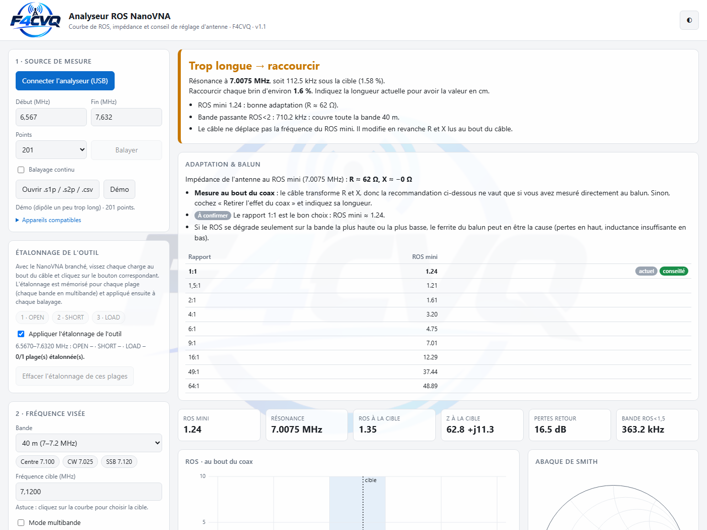
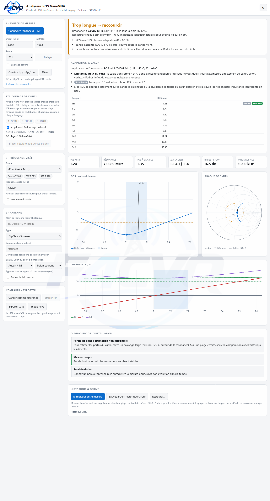

  

<h1 align="center">Analyseur ROS NanoVNA</h1>

  <b>Courbe de ROS, impédance et conseil de réglage d'antenne pour radioamateurs</b> 
  Faut-il raccourcir ou allonger l'antenne, et de combien ? L'outil vous le dit, en centimètres.

  <a href="https://github.com/F4CVQ/outils-nanovna/releases/latest"><b>⬇ Télécharger la v1.1</b></a> ·
  <a href="#démarrage-rapide"><b>Démarrage rapide</b></a> ·
  <a href="#appareils-compatibles"><b>Appareils compatibles</b></a>

---

## En bref

- **Un seul fichier HTML**, sans installation : il s'ouvre dans Chrome ou Edge, fonctionne hors ligne et n'envoie aucune donnée sur Internet.
- **Connexion directe au NanoVNA** par USB (Web Serial), **tous modèles et firmwares** détectés automatiquement.
- Ou **ouverture de fichiers** `.s1p`, `.s2p` et `.csv` venant de NanoVNA-Saver, NanoVNA-App, NanoVNA-QT ou de tout autre analyseur.

## Fonctionnalités

### Réglage d'antenne
- Verdict clair : **« Trop longue → raccourcir »** ou **« Trop courte → allonger »**, avec la correction en **cm** et une première coupe prudente (on ne rallonge pas un fil coupé).
- Sensibilité « 1 cm ≈ N kHz », bande passante ROS < 2 et ROS < 1,5, couverture de la bande.
- **16 types d'antennes**, avec des conseils adaptés à chacun :
  - filaires et verticales : dipôle, dipôle en éventail, OCF/Windom, EFHW, quart d'onde, boucle, antenne raccourcie ;
  - beams : Yagi monobande, Yagi à trappes, Moxon, Hexbeam, Quad, HB9CV, log-périodique.
- Bandes IARU Région 1 de 160 m à 23 cm, avec cible au centre de bande, en CW ou en SSB, ou au clic sur la courbe.

### Graphiques
- **ROS** en échelle logarithmique, avec la bande grisée.
- **Impédance** R, X et |Z|.
- **Abaque de Smith**.
- **Mesure de référence** affichée en pointillés, pour voir l'effet d'une coupe.

### Mode multibande
- Cochez plusieurs bandes : l'analyseur les balaie **une par une** et donne un verdict pour chacune.
- Un **mini-graphique par bande**.
- **Effet d'une modification** sur chaque bande : par exemple « 20 m +279 kHz, 15 m +57 kHz, 40 m +13 kHz ».
- **Compromis de longueur** pour les antennes à un seul fil (EFHW, OCF, dipôle sur ses harmoniques), et **ordre de réglage** pour les antennes à trappes ou en éventail.

### Balun et câble coaxial
- Rapport du balun ou de l'unun (1:1 à 64:1) et type (courant, tension, unun). L'outil calcule l'**impédance réelle de l'antenne** et le **rapport conseillé**, y compris en multibande.
- **Retrait de l'effet du coax** : indiquez la longueur et le type de câble (RG58, RG213, Aircell 7, Ecoflex…), et l'outil calcule les valeurs au point d'alimentation.

### Diagnostic et suivi
- Estimation des **pertes du câble**, détection d'une **mesure bruitée** (connecteur douteux) ou d'un **étalonnage incohérent**.
- **Historique par antenne** avec détection de **dérive** : résonance qui bouge, ROS qui se dégrade, pertes en hausse (eau dans le coax…).
- Sauvegarde et restauration de l'historique en `.json`, export `.s1p` et image PNG.

### Étalonnage intégré
- Étalonnage **OPEN / SHORT / LOAD** dans l'outil, mémorisé **pour chaque plage et chaque bande**.
- Il est indispensable pour les NanoVNA V2 et LiteVNA, qui envoient des mesures brutes.
- Il est très utile avec les anciens firmwares, qui n'adaptent pas leur étalonnage quand on change de plage.

## Appareils compatibles

Le modèle et le protocole sont **détectés automatiquement** à la connexion.

| Famille | Appareils | Protocole |
|---|---|---|
| Firmware récent | NanoVNA-H, H4 (DiSlord, hugen, ttrftech…), NanoVNA-F V2/V3, SV4401A, SV6301A, JNCRadio VNA 3G | console texte, commande `scan` |
| Ancien firmware (2019) | NanoVNA d'origine | console texte, mode compatibilité automatique (sans `scan`, avec réparation des valeurs abîmées) |
| Protocole binaire | NanoVNA V2 / SAA-2, V2_2, V2Plus4, LiteVNA | binaire V2, jusqu'à 1024 points, étalonnage de l'outil |
| Tous les autres | miniVNA, RigExpert, logiciels NanoVNA-Saver / App / QT… | import d'un fichier `.s1p` |

## Démarrage rapide

1. Téléchargez `Analyseur-ROS-NanoVNA.html` depuis la [dernière version](https://github.com/F4CVQ/outils-nanovna/releases/latest), et si vous voulez `demo-s1p.zip` pour les fichiers de démonstration. Pour voir la démo, ajoutez `?demo` à la fin de l'adresse dans le navigateur.
2. Ouvrez-le dans **Chrome** ou **Edge** sur ordinateur : la connexion USB a besoin de Web Serial. Les fichiers et la démo fonctionnent dans tous les navigateurs.
3. Branchez le NanoVNA. Sous Windows 10 et 11, **aucun pilote n'est nécessaire**.
4. Cliquez sur **Connecter l'analyseur (USB)** et choisissez le port COM.
5. Étalonnez au bout du câble, sur l'appareil ou avec l'étalonnage de l'outil.
6. Branchez l'antenne, choisissez la bande, puis cliquez sur **Balayer**.

> Fermez NanoVNA-Saver ou tout autre logiciel qui utilise le port : un seul programme peut s'y connecter à la fois.

## Fichiers de démonstration

Le dossier [`demo-s1p`](demo-s1p) contient des mesures simulées pour essayer l'outil sans appareil :

- **Dipôle 40 m** : trop long, accordé, puis coax mouillé (pour tester la détection de dérive).
- **Quart d'onde 20 m** trop court.
- **Ground-plane 2 m** avec un connecteur douteux.
- **EFHW 80–10 m** et **dipôle en éventail 40/20/15 m**, avant et après une coupe (mode multibande).
- **Delta loop 40 m** avec un balun 4:1 : l'outil doit conseiller un 2:1.
- **Boucle horizontale 80–10 m** avec un balun 4:1.
- **Boucle de 83 m** sur les 9 bandes de 80 à 10 m.

## Confidentialité

Tout fonctionne **dans votre navigateur**. Aucune mesure n'est envoyée sur Internet. L'historique et les étalonnages sont gardés localement, dans le stockage du navigateur.

## Historique des versions

### v1.1
- Prise en charge de **tous les protocoles NanoVNA** avec détection automatique :
  - binaire V2 (NanoVNA V2, V2Plus4, LiteVNA) ;
  - firmwares récents ;
  - anciens firmwares de 2019, sans `scan`.
- **Étalonnage OPEN/SHORT/LOAD intégré**, par plage et par bande.
- Mode compatibilité pour les anciens firmwares : réparation des valeurs abîmées et relecture des lignes perdues.
- Nouveau logo F4CVQ et lien direct vers la démo (`?demo`).

### v1.0
- Courbe de ROS, impédance, abaque de Smith, verdict raccourcir ou allonger en cm.
- Mode multibande, balun et coax, diagnostic, historique et dérive, 16 types d'antennes.

## Licence

**Utilisation libre et gratuite pour tous**. Le code reste la propriété de F4CVQ : pas de modification, de redistribution modifiée ni de réutilisation du code sans accord. Voir [LICENSE](LICENSE).

## Auteur

Développé par **F4CVQ**, 73 !

Suggestions et retours bienvenus dans les [issues](https://github.com/F4CVQ/outils-nanovna/issues).
